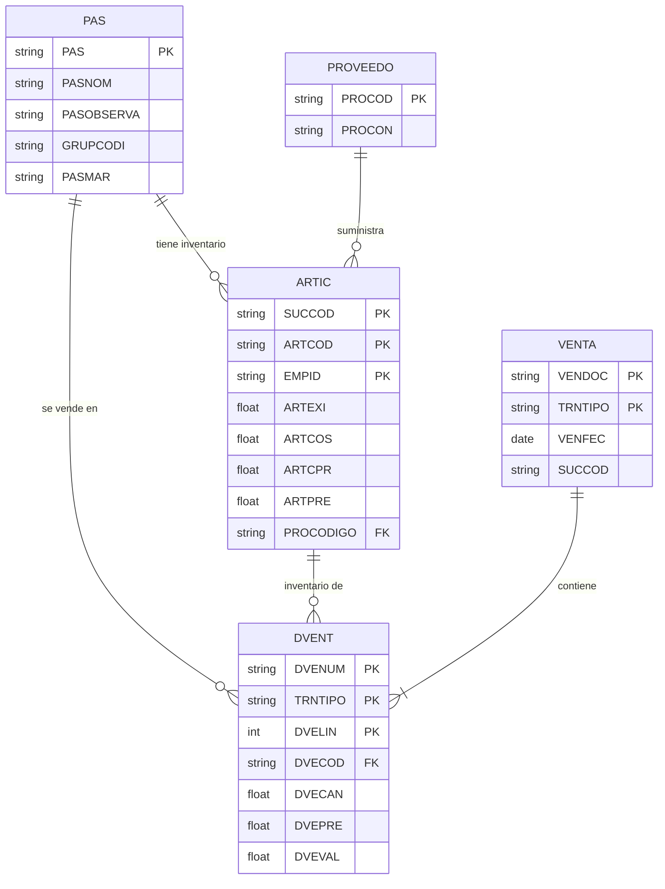

# 📊 Mapeo de Datos - Sistema de Reportes

Este documento describe **de dónde proviene cada dato** en el sistema de reportes de inventario y ventas.

---

## 📋 Tabla de Contenidos

1. [Estructura de Base de Datos](#estructura-de-base-de-datos)
2. [Tablas Principales](#tablas-principales)
3. [Reportes y sus Fuentes de Datos](#reportes-y-sus-fuentes-de-datos)
4. [Mapeo Detallado por Reporte](#mapeo-detallado-por-reporte)

---

## 🗄️ Estructura de Base de Datos

El sistema utiliza una base de datos MySQL llamada **`pv`** con las siguientes tablas principales:

| Tabla | Descripción | Tipo |
|-------|-------------|------|
| `artic` | Inventario de productos por sucursal | Estática |
| `pas` | Catálogo/maestro de productos | Estática |
| `proveedo` | Información de proveedores | Estática |
| `venta{año}` | Encabezados de ventas (dinámico por año) | Dinámica |
| `dvent{año}` | Detalles de ventas (dinámico por año) | Dinámica |

> **Nota**: Las tablas de ventas son **dinámicas** y tienen un sufijo de año. Por ejemplo: `venta25` para 2025, `dvent25` para detalles de ventas de 2025.

---

## 🗂️ Tablas Principales

### 1. Tabla `artic` - Inventario de Productos

**Propósito**: Almacena el inventario actual de cada producto en cada sucursal.

**Clave Primaria Compuesta**:
- `SUCCOD` (String) - Código de sucursal
- `ARTCOD` (String) - Código del artículo
- `EMPID` (String) - ID de empresa

**Campos Principales**:

| Campo | Tipo | Descripción | Mapeo en UI |
|-------|------|-------------|-------------|
| `ARTEXI` | Float | Existencia actual | `existencia` |
| `ARTFIS` | Float | Inventario físico | `inventarioFisico` |
| `ARTSEP` | Float | Cantidad separada/reservada | `cantidadSeparada` |
| `ARTFEC` | Date | Fecha última compra | `fechaUltimaCompra` |
| `ARTCOS` | Float | **Costo actual del artículo** | `costo_articulo` |
| `ARTCPR` | Float | **Costo promedio** | `costo_promedio` |
| `ARTPRE` | Float | Precio de venta | `precioVenta` |
| `PASPREBAS` | Float | Precio base | `precioBase` |
| `ARTIVA` | Float | IVA del producto | `iva` |
| `ARTPORCENT` | Float | Porcentaje de ganancia | `porcentajeGanancia` |
| `ARTPUNMAX` | Float | Punto máximo de inventario | `puntoMaximo` |
| `ARTPUNPED` | Float | Punto de reorden | `puntoPedido` |
| `ARTPUNMIN` | Float | Punto mínimo de inventario | `puntoMinimo` |
| `PROCODIGO` | String | Código del proveedor | `proveedor` |
| `PROCOMPRA` | String | Proveedor de compra | `proveedorCompra` |
| `PASESTADO` | String | Estado del producto (ACT/INA) | `estado` |
| `PASCLASE` | String | Clasificación | `clasificacion` |
| `UBICODIGO` | String | Ubicación en bodega | `ubicacion` |
| `ARTOBSERVA` | String | Observaciones | `observaciones` |
| `PASVENDIDO` | Float | Cantidad vendida histórica | `cantidadVendida` |
| `unidexis` | Float | Unidades en existencia | `existenciaUnidades` |

**Campos Calculados en el Backend**:
- `valorInventario` = `ARTEXI * ARTCPR` (Valor a costo promedio)
- `valorInventarioPrecio` = `ARTEXI * ARTPRE` (Valor a precio de venta)
- `disponible` = `ARTEXI - ARTSEP` (Existencia disponible)

---

### 2. Tabla `pas` - Catálogo de Productos

**Propósito**: Catálogo maestro con información descriptiva de todos los productos.

**Clave Primaria**:
- `PAS` (String) - Código único del producto

**Campos Principales**:

| Campo | Tipo | Descripción | Mapeo en UI |
|-------|------|-------------|-------------|
| `PAS` | String | **Código del producto** (PK) | `codigo` |
| `PASNOM` | String | **Nombre del producto** | `nombre_producto` / `descripcion` |
| `PASOBSERVA` | Text | Descripción detallada | `descripcion_producto` |
| `PASTIPO` | String | Tipo de producto | `tipo` |
| `GRUPCODI` | String | Código de grupo/categoría | `grupo` |
| `PASMAR` | String | Marca | `marca` |
| `PASEST` | Boolean | Estado activo/inactivo | `estado` |
| `PROGRAMA` | String | Programa asociado | - |
| `PUCCOD` | String | Código PUC contable | - |

**Relación**: 
- Se une con `artic` mediante `PAS == ARTCOD`

---

### 3. Tabla `proveedo` - Proveedores

**Propósito**: Información de proveedores.

**Clave Primaria**:
- `PROCOD` (String) - Código del proveedor

**Campos Principales**:

| Campo | Tipo | Descripción | Mapeo en UI |
|-------|------|-------------|-------------|
| `PROCOD` | String | Código del proveedor (PK) | `codigo` |
| `PROCON` | String | **Nombre del proveedor** | `nombre_proveedor` |
| `PRONUMDOC` | String | Número de documento | `numerodocumento` |
| `PROTIPDOC` | String | Tipo de documento | `tipodocumento` |
| `PROTEL2` | String | Teléfono 2 | `telefono2` |
| `PROTEL3` | String | Teléfono 3 | `telefono3` |
| `PROPAG` | String | Forma de pago | - |
| `PROPLAENT` | Float | Plazo de entrega | - |
| `status` | String | Estado | `status` |

**Relación**: 
- Se une con `artic` mediante `PROCOD == PROCODIGO`

---

### 4. Tabla `venta{año}` - Encabezados de Ventas (Dinámica)

**Propósito**: Almacena información de encabezados de ventas por año.

**Ejemplo**: `venta25` para el año 2025

**Clave Primaria Compuesta**:
- `VENDOC` (String) - Número de documento
- `TRNTIPO` (String) - Tipo de transacción

**Campos Principales**:

| Campo | Tipo | Descripción | Uso |
|-------|------|-------------|-----|
| `VENDOC` | String | Número de documento (PK) | Identificador de venta |
| `TRNTIPO` | String | Tipo de transacción (PK) | Tipo de documento |
| `SUCCOD` | String | Código de sucursal | Filtro por sucursal |
| `VENFEC` | Date | **Fecha de venta** | Filtro por rango de fechas |
| `VENHOR` | String | Hora de venta | - |
| `VENCLI` | String | Código del cliente | - |
| `VENNOM` | String | Nombre del cliente | - |
| `VENVAL` | Float | Valor total de la venta | - |
| `VENDES` | Float | Descuento aplicado | - |
| `VENIMP` | Float | Impuestos | - |
| `VENEST` | String | Estado de la venta | - |
| `VENNAR` | Float | Unidades narradas | - |
| `FACELECESTA` | String | Estado factura electrónica | - |

---

### 5. Tabla `dvent{año}` - Detalles de Ventas (Dinámica)

**Propósito**: Almacena el detalle (líneas) de cada venta.

**Ejemplo**: `dvent25` para el año 2025

**Clave Primaria Compuesta**:
- `DVENUM` (String) - Número de documento
- `TRNTIPO` (String) - Tipo de transacción
- `DVELIN` (Integer) - Número de línea

**Campos Principales**:

| Campo | Tipo | Descripción | Uso en Reportes |
|-------|------|-------------|-----------------|
| `DVENUM` | String | Número de documento (PK) | JOIN con venta |
| `TRNTIPO` | String | Tipo de transacción (PK) | JOIN con venta |
| `DVELIN` | Integer | Línea del detalle (PK) | Orden |
| `DVECOD` | String | **Código del producto vendido** | Agrupar por producto |
| `DVECAN` | Float | **Cantidad vendida** | `cuantos_se_vendio` |
| `DVEPRE` | Float | **Precio unitario de venta** | `precio_promedio` |
| `DVEVAL` | Float | **Valor total de la línea** | `valor_total_vendido` |
| `DVEDESCUEN` | Float | Descuento de la línea | - |
| `DVEIMP` | Float | Impuesto de la línea | - |
| `PASCOS` | Float | Costo del producto (backup) | Cálculo de utilidad |
| `SUCCOD` | String | Sucursal | Filtro |

---

## 📈 Reportes y sus Fuentes de Datos

### Reporte 1: **Inventario**

**Endpoint**: `/api/reportes?tipo=inventario`

**Fuentes de Datos**:
```
artic (principal) 
  ⟵ LEFT JOIN pas ON artic.ARTCOD = pas.PAS
  ⟵ LEFT JOIN proveedo ON artic.PROCODIGO = proveedo.PROCOD
```

**Datos Retornados**:
| Campo en Respuesta | Origen | Cálculo |
|--------------------|--------|---------|
| `codigo` | `artic.ARTCOD` | - |
| `nombreProducto` | `pas.PASNOM` | - |
| `descripcionProducto` | `pas.PASOBSERVA` | - |
| `nombreProveedor` | `proveedo.PROCON` | - |
| `existencia` | `artic.ARTEXI` | - |
| `costoPromedio` | `artic.ARTCPR` | - |
| `precioVenta` | `artic.ARTPRE` | - |
| `valorInventario` | - | `ARTEXI * ARTCPR` |
| `valorInventarioPrecio` | - | `ARTEXI * ARTPRE` |
| `disponible` | - | `ARTEXI - ARTSEP` |
| `alertas.bajoPuntoMinimo` | - | `ARTEXI < ARTPUNMIN` |
| `alertas.puntoReorden` | - | `ARTEXI <= ARTPUNPED` |
| `alertas.sobreMaximo` | - | `ARTEXI > ARTPUNMAX` |

---

### Reporte 2: **Productos Vendidos**

**Endpoint**: `/api/reportes/productos-vendidos`

**Fuentes de Datos**:
```
dvent{año} (principal)
  ⟵ INNER JOIN venta{año} ON (dvent.DVENUM = venta.VENDOC AND dvent.TRNTIPO = venta.TRNTIPO)
  ⟵ LEFT JOIN pas ON dvent.DVECOD = pas.PAS
  ⟵ LEFT JOIN artic ON dvent.DVECOD = artic.ARTCOD
```

> **Importante**: El año se determina automáticamente desde `filtros.fechaFin` o `filtros.fechaInicio`

**Agrupación**: Por `DVECOD` (código de producto)

**Datos Retornados**:
| Campo en Respuesta | Origen | Cálculo/Agregación |
|--------------------|--------|-------------------|
| `codigo` | `dvent.DVECOD` | - |
| `descripcion` | `pas.PASNOM` | COALESCE(pas.PASNOM, dvent.DVECOD) |
| `cuantos_se_vendio` | `dvent.DVECAN` | SUM(DVECAN) |
| `precio_promedio` | `dvent.DVEPRE` | AVG(DVEPRE) |
| `valor_total_vendido` | `dvent.DVEVAL` | SUM(DVEVAL) |
| `existencias` | `artic.ARTEXI` | COALESCE(artic.ARTEXI, 0) |
| `costo_promedio` | `artic.ARTCPR` | COALESCE(artic.ARTCPR, 0) |
| `costo_articulo` | `artic.ARTCOS` | COALESCE(artic.ARTCOS, 0) |
| `marca` | `pas.PASMAR` | - |
| `proveedor` | `artic.PROCODIGO` | - |

**Orden**: Por `valor_total_vendido` (Mayor a Menor)

**Filtros Aplicables**:
- `filtros.codigo` → `dvent.DVECOD LIKE '%{codigo}%'`
- `filtros.sucursal` → `venta.SUCCOD = {sucursal}`
- `filtros.fechaInicio` → `venta.VENFEC >= {fechaInicio}`
- `filtros.fechaFin` → `venta.VENFEC <= {fechaFin}`
- `filtros.proveedor` → `artic.PROCODIGO = {proveedor}`
- `filtros.grupo` → `pas.GRUPCODI = {grupo}`

---

### Reporte 3: **Utilidad/Ganancias**

**Endpoint**: `/api/reportes/utilidad`

**Fuentes de Datos**:
```
dvent{año} (principal)
  ⟵ INNER JOIN pas ON dvent.DVECOD = pas.PAS  (INNER para garantizar nombre)
  ⟵ LEFT JOIN artic ON (dvent.DVECOD = artic.ARTCOD AND dvent.SUCCOD = artic.SUCCOD)
  ⟵ INNER JOIN venta{año} ON (dvent.DVENUM = venta.VENDOC AND dvent.TRNTIPO = venta.TRNTIPO)
```

**Agrupación**: Por `DVECOD`, `PASNOM`, `ARTCPR`, `ARTCOS`

**Datos Retornados**:
| Campo en Respuesta | Origen | Cálculo/Agregación |
|--------------------|--------|--------------------|
| `codigo` | `dvent.DVECOD` | - |
| `descripcion` | `pas.PASNOM` | - |
| `cuantos_se_vendio` | `dvent.DVECAN` | SUM(DVECAN) |
| `costo_promedio` | `artic.ARTCPR` | COALESCE(artic.ARTCPR, dvent.PASCOS, 0) |
| `costo_articulo` | `artic.ARTCOS` | COALESCE(artic.ARTCOS, 0) |
| `precio_de_venta` | `dvent.DVEPRE` | AVG(DVEPRE) |
| `ganancia_en_pesos` | - | SUM(DVEPRE * DVECAN) - SUM(costo * DVECAN) |
| `total_ventas` | - | SUM(DVEPRE * DVECAN) |
| `ganancias_en_porcentaje` | - | (ganancia_en_pesos / total_ventas) * 100 |

**Orden**: Por `ganancias_en_porcentaje` DESC, luego `ganancia_en_pesos` DESC

**Filtros Aplicables**: (Mismos que Productos Vendidos)

---

## 🔑 Campos Clave Explicados

### Diferencia entre `ARTCOS` vs `ARTCPR`

| Campo | Descripción | Uso |
|-------|-------------|-----|
| `ARTCOS` (Costo Artículo) | Costo de la **última compra** | Cálculo de ganancia actual |
| `ARTCPR` (Costo Promedio) | Costo **promedio ponderado** histórico | Valoración de inventario |

**En los reportes de utilidad**:
- Se usa `ARTCPR` como costo principal
- Si `ARTCPR` no existe, se usa `PASCOS` (costo guardado en el detalle de venta)
- `ARTCOS` se incluye como referencia adicional

### Campos Calculados Importantes

#### 1. Ganancia en Pesos
```sql
SUM(DVEPRE * DVECAN) - SUM(ARTCPR * DVECAN)
```
= (Total de Ventas) - (Total de Costos)

#### 2. Ganancia en Porcentaje (Margen)
```sql
(ganancia_en_pesos / total_ventas) * 100
```

#### 3. Valor de Inventario a Costo
```sql
ARTEXI * ARTCPR
```

#### 4. Valor de Inventario a Precio de Venta
```sql
ARTEXI * ARTPRE
```

#### 5. Disponible
```sql
ARTEXI - ARTSEP
```

---

## 📊 Estadísticas de Reportes

### Reporte de Inventario

**Estadísticas Calculadas**:
- `totalItems` = COUNT(productos)
- `totalExistencias` = SUM(existencia)
- `valorTotalCosto` = SUM(existencia * costoPromedio)
- `valorTotalVenta` = SUM(existencia * precioVenta)
- `utilidadPotencial` = valorTotalVenta - valorTotalCosto

### Reporte de Productos Vendidos

**Estadísticas Calculadas**:
- `totalProductos` = COUNT(productos distintos)
- `totalCantidadVendida` = SUM(cuantos_se_vendio)
- `totalValorVendido` = SUM(valor_total_vendido)

### Reporte de Utilidad

**Estadísticas Calculadas**:
- `totalProductos` = COUNT(productos distintos)
- `totalVentas` = SUM(total_ventas)
- `totalGananciaPesos` = SUM(ganancia_en_pesos)
- `porcentajeGananciaTotal` = (totalGananciaPesos / totalVentas) * 100

---

## 🔄 Relaciones entre Tablas



---

## 📝 Notas Importantes

1. **Tablas Dinámicas de Ventas**: Las tablas `venta{año}` y `dvent{año}` son dinámicas. El sistema determina automáticamente el año desde los filtros de fecha.

2. **Joins LEFT vs INNER**:
   - Inventario usa **LEFT JOIN** porque algunos productos pueden no tener proveedor o descripción
   - Utilidad usa **INNER JOIN con pas** para garantizar que todos los productos tengan nombre

3. **Costo por Defecto**: En reportes de utilidad, si no hay `ARTCPR`, se usa `PASCOS` (costo guardado en la venta)

4. **Filtros Comunes**: Todos los reportes aceptan filtros por:
   - Código de producto
   - Sucursal
   - Rango de fechas
   - Proveedor
   - Grupo/Categoría

5. **Formato de Numbers**: Valores monetarios mayores a 10,000 se formatean con sufijos K (miles) o M (millones) en las estadísticas.

---

## 🛠️ Archivos Relevantes

| Archivo | Propósito |
|---------|-----------|
| `backend/app/models/database.py` | Modelos SQLAlchemy (artic, pas, proveedo) |
| `reports.py` | Modelos dinámicos (venta, dvent) y lógica de reportes |
| `backend/app/services/reporte_service.py` | Servicios de reportes |
| `backend/app/routes/reportes.py` | Endpoints REST API |

---

**Última Actualización**: 2026-02-05
